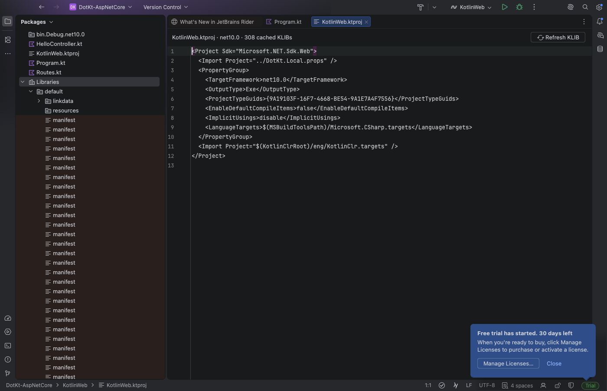

# DotKtR

DotKt `.ktproj` 的 Rider 插件，当前版本 `0.1.1-dev`。

现在有独立的插件前端、ReSharper 后端、设置页、MSBuild 项目导入、Gradle 打包和安装验证。实验原型保留在 `spikes/` 供复现，未打入插件。当前仍需要固定版本的 Kotlin/Java 兼容宿主，属于可安装的早期预览，尚未发布到 Marketplace。

## 当前功能

- 自动从已加载的 solution 发现 `.ktproj`，通过公开 MSBuild targets 解析源码、CLR stdlib 和 DLL 依赖，按需生成程序集 KLIB。
- 原生 Kotlin PSI/K2 的染色、诊断、类型推导和成员补全。
- Cmd＋左键通过 ReSharper 进入 C# 源码或 Rider 的外部库导航流程。
- 顶层普通 `main` 使用原生 `.NET Project` 配置，运行前执行项目级 Clean＋Build，支持控制台和 Stop。
- IDE 独立保存完整 KLIB 快照，项目 Clean 不会删除编辑器正在使用的库；刷新失败时保留上一份快照。
- `.ktproj` 文本编辑器顶部右侧提供 **Refresh KLIB** 按钮，显示解析状态；`Tools | Refresh DotKt Project` 也可手动刷新。
- `Settings | Languages & Frameworks | DotKt` 配置 dotnet、项目和目标框架。
- 项目文件、已导入引用 DLL、已监视工具链文件，以及项目目录下 Kotlin 文件的增删可触发刷新；普通 Kotlin 文本编辑不重新运行 MSBuild。
- MSBuild 仅在 Rider 已信任的项目中运行；取消导入和关闭项目会结束其解析进程。

## 固定的开发与运行基线

| 组件 | 版本 |
| --- | --- |
| Rider | 2026.2.3.1，`262.10968.170` |
| IDEA Kotlin/Java 组件来源 | 2026.2.3，`262.10968.63` |
| DotKt Kotlin | `2.4.10` |
| Gradle Wrapper | `8.14.4` |
| Gradle JVM / 编译 toolchain | JDK 21 / JDK 25 |
| 本轮 GUI 验证 | macOS arm64，.NET SDK 10 |

Kotlin/Java 宿主适配仍是明确的产品化限制。`prepareSandbox` 从本机 IDEA 复制这两个插件到隔离沙箱，提供 Java capability，并补入两个原始 marker interface、移除与 Rider 冲突的 `CompileFile` 注册。工具严格检查 SDK build，记录适配摘要，不修改已安装的 IDE；这些 JetBrains 二进制不进入 Git，也不进入 DotKtR ZIP。

宿主还必须在启动前设置 `-Dkotlin.index.non.source.roots=true`，让 `.ktproj` 文件进入 Kotlin stub 索引。`runIde` 与安装验证启动器会设置此 Kotlin 开关；手动准备宿主时需在 Rider 的自定义 VM options 中添加并重启。插件导入会检查该条件，不能用启动后的属性修改替代它。

## 构建与运行

在本目录运行。IDE 路径可通过 `-PriderPath=...`、`-PideaPath=...` 或环境变量 `RIDER_HOME`、`IDEA_HOME` 指定；路径指向包含 `lib` 的 IDE 根目录，macOS 为 `.app/Contents`。

```bash
# macOS 开发环境示例；另需已安装 JDK 25，供 Gradle toolchain 查找。
export JAVA_HOME=$(/usr/libexec/java_home -v 21)
./gradlew -PdotnetPath="$HOME/.dotnet/dotnet" buildPlugin verifyPluginStructure test

# 在隔离的、已准备兼容组件的 Rider 中打开真实 solution。
./gradlew -PdotnetPath="$HOME/.dotnet/dotnet" runIde -Psolution=/absolute/path/App.sln
```

产物为 `build/distributions/DotKtR-0.1.1-dev.zip`，包含 JVM 插件及 `DotKtR.Backend.dll`。在已经准备好匹配 Kotlin/Java 组件的 Rider 宿主中，可以使用 **Install Plugin from Disk** 安装该 ZIP。普通 Rider 上只安装这一份 ZIP，尚不能替代上述兼容宿主准备；当前不应将其描述为任意 Rider 版本上开箱即用的 Marketplace 插件。

Rider 授权使用正常 IDE 授权流程。构建和发布包不含授权文件。

`.ktproj` 自身应已配置可用的 DotKt SDK/targets 与工具链。插件调用项目公开的 MSBuild target，不依赖 `spikes` 的输入快照，也不自动安装或更换 DotKt 编译器。首次导入会执行 restore 与 KLIB 解析，缺少 SDK 或项目引用产物时在设置页和通知中显示错误。

## KLIB 缓存与刷新

缓存位于 Rider system 目录下的 `dotktr/klib-cache-v1`，与项目的 `bin/obj` 分开。这里保存的是 DotKt `dll2klib` 生成的真实 KLIB，含 CLR 标准库副本。加载项目先恢复最近一次完整快照，再用 MSBuild 解析当前引用；DLL 内容、引用集合、TFM、RID、标准库和投影工具未变化时直接复用缓存。

点击 `.ktproj` 右上方的 **Refresh KLIB** 会先保存该项目文件，再重新检查引用和缓存。它不无条件重生成所有库：只有输入改变、缓存缺失或损坏时才重新投影。完整结果先写入私有临时目录、校验后发布；内容相同的 KLIB 复用原路径，内容改变则创建新路径并切换模块。刷新期间旧快照继续可用，失败时明确显示正在保留旧快照。旧快照可能落后于当前 DLL，恢复依赖后需要刷新。

已知正在进行的 Rider 原生构建会推迟刷新；如果外部构建同时改写输入，会拒绝发布不一致的快照并提示重试。程序集身份随快照保存，导航不依赖缓存 KLIB 旁边存在原始 DLL。同项目 C# 源码混编不在这一层处理范围内。

当前只删除生成过程的临时目录，不在 IDE 运行期间清理旧快照，避免删除仍被索引或打开的库。缓存容量管理留待后续；删除 IDE 缓存后，下一次成功导入会重新生成。

## 安装级验证

先按 [实验 README](spikes/native-psi/README.md) 准备本地 ASP.NET Core 样例及 DotKt 工具链，再执行：

```bash
./gradlew -PdotnetPath="$HOME/.dotnet/dotnet" buildPlugin integrationDriverJar
python3 tools/smoke_installed.py --foreground
```

该验证从 ZIP 安装插件到全新 Rider 沙箱，不传实验模块或 KLIB 快照。独立测试插件检查自动导入、K2 诊断、补全、编辑器刷新按钮、仅 Clean 后的编辑能力、刷新失败保留快照、声明导航、.NET Run、编译失败和源码修改后重跑；测试插件及其源码不会进入产品 ZIP。运行输出保存在 `build/installed-smoke-*/report.json`。

2026-10-13 的 [安装回归](docs/evidence/installed-plugin-smoke.json) 全部通过：自动解析 3 个源码 / 308 个 KLIB、源码增删 3→4→3、零 K2 错误、27 个实际补全候选、5 次外部 C# 导航及 Kotlin 本地跳转、原生 Clean＋Build / HTTP / Stop、编译失败拦截和修改后重跑。[产物与源码审计](docs/evidence/installed-plugin-audit.json) 包含 ZIP 摘要、5 个单元测试结果及测试源码恢复检查。

同日 `0.1.1-dev` 的 [KLIB 缓存安装回归](docs/evidence/klib-cache-smoke.json) 通过：点击编辑器按钮可复用缓存；仅执行 Clean 删除项目内 307 个 KLIB 后，308 个 IDE 缓存库仍完整，3 个源码均无 K2/编辑器诊断错误，补全仍有 27 个候选。人为设置无效 dotnet 路径后，刷新显示失败并保留可用模型，恢复后再次命中缓存；原有导航、Run、失败拦截和重跑检查也通过。[本版审计](docs/evidence/klib-cache-audit.json) 记录 ZIP 与实际安装文件一致、缓存内容摘要、10 个单元测试及样例源码恢复结果。磁盘恢复和 DLL/TFM/RID/工具链失效判定有单元测试覆盖；DLL 替换自动刷新、关闭重开流程尚未单独进行 GUI 验收。



## 当前边界

- 一次导入一个 `.ktproj`；多个项目时需在设置中选择。原生 main 与导航当前要求消费项目唯一对应可用的 .NET 模块；多 TFM 运行和导航仍需扩展。
- Kotlin 源码应位于项目目录内；外部链接源码会明确拒绝导入。
- `suspend main`、对象内 main、Kotlin 断点/单步、Hot Reload、跨语言重命名和查找引用尚未验收。
- 复杂 CLR 投影、嵌套泛型、索引器和运算符来源映射仍不完整。
- 项目外的 props/targets 修改后需手动刷新；MSBuild 解析失败时保留先前已成功导入的模型，状态显示正在使用旧快照。
- 使用 Kotlin 内部/实验 API 和非持久模块，仍有已知 workspace cache 警告，升级 SDK 前必须重新验证。
- 固定 DotKt 版本的增量 IL 输出存在一个 Rider 触发的边界：C# 占位程序集被重新生成后，IL emit 可能误判为最新。当前为 DotKt 的默认 Build 任务前插入原生项目 Clean，代价是 Run 会重新生成构建侧 KLIB/BIR/CIR；IDE 使用独立的缓存快照。不修改编译器私有 stamp，后续应由上游修正增量判定再恢复增量构建。
- 尚未执行完整 Plugin Verifier 跨版本兼容矩阵，也未验收 Windows/Linux。

## 工程组织

- `src/rider/main`：产品前端与插件描述。
- `src/dotnet/DotKtR.Backend`：ReSharper 导航服务。
- `src/rider/test`：项目元数据、缓存恢复、失效判定与原子发布测试。
- `src/rider/integrationTest`：独立安装验证驱动。
- `third_party/dotkt`：固定 commit 的五个未修改 CLR 规则文件，附 Apache-2.0 许可、来源和摘要。
- `spikes/native-psi`：历史原型与样例。
- `docs`：阶段报告与运行证据；历史报告描述的是当时版本，不代表全部检查在每次更改后重跑。

原先未使用的 ReSharper/.NET Framework 模板、空 RD 生成工程及模板发布脚本已移出活动工程。开发后端可打开仓库根目录的 `DotKtR.sln`；独立 .NET 构建需传入 `-p:RiderHost=/path/to/Rider/lib/ReSharperHost`。
