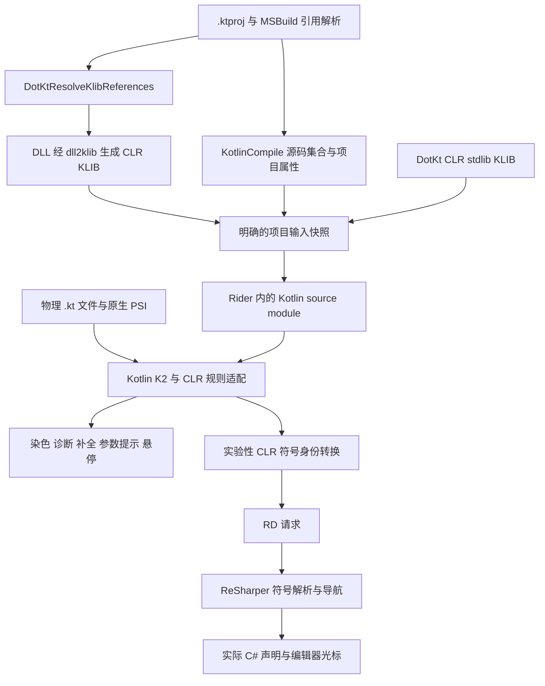

# DotKtR 技术能力与产品化评估报告

> 插件工程补充：当前已有 `0.1.0-dev` 独立插件、MSBuild 导入和标准 Gradle ZIP 构建；使用条件与边界以 [插件 README](../README.md) 为准。下文保留原型阶段的验证范围和历史证据。

评估日期：2026-10-13。对象：当前仓库的 Rider 原生 Kotlin 验证原型，以及固定版本 DotKt 工具链下的混合语言、ASP.NET Core 和 Controller 样例。

## 结论

**在 Rider 内复用 Kotlin PSI、K2 和编辑器服务，为 DotKt 提供 IDE 支持，这条路线已经具备实际可行性。当前完成度是可交互、可运行真实应用的技术原型，尚未成为可安装后自动支持任意 `.ktproj` 的正式插件。**

已经跨过三个主要验证门槛：

1. **编辑器交互**：实际 Rider 窗口中的语法与语义染色、类型推导、错误标记及修复、手动和自动成员补全、候选插入、参数提示、悬停签名已在样例中通过验证。
2. **真实框架与应用**：载入了包含三个 Kotlin 文件的 ASP.NET Core 项目，使用真实框架程序集投影出的 KLIB；Minimal API、Kotlin Controller、路由参数绑定和 data class JSON 返回均完成实际构建与 HTTP 验证。
3. **ReSharper 复用**：已接入普通 Cmd＋左键 / Go to Declaration。两个项目内 C# 重载，以及 ASP.NET Core 的类型、实例方法、扩展方法和属性，均实际打开对应 C# 源码并定位到正确声明。完整投影来源和复杂签名覆盖仍待扩展。

建议继续原生路线。当前主要工程量在项目导入与刷新、版本和模块隔离、通用符号映射及插件交付，而不是重新证明 Kotlin 分析器能否在 Rider 中运行。

## 当前能力清单

“已验证”均指下面列出的样例和版本。“未完成”表示当前实现尚不提供该能力；“未验收”表示现有结果不能支持可用性结论，不等于技术上不可行。

| 能力 | 当前状态 | 已验证范围与实际边界 |
| --- | --- | --- |
| Rider 内的原生 Kotlin PSI | 已验证 | Rider 的 `PsiManager` 返回物理 `KtFile`，不是外部进程中的模拟 PSI |
| Kotlin 语法染色 | GUI 已验证 | 关键字、字符串、数字、注解等正常显示 |
| Kotlin 语义染色 | GUI 已验证 | 样例中的类型、方法、属性、参数等有语义颜色；未做所有主题和语言结构的覆盖测试 |
| 类型推导与重载解析 | 已验证 | `Int` / `String` 重载、泛型函数、泛型类、成员返回类型及部分 CLR 继承静态成员 |
| 实时语法错误 | GUI 已验证 | 未闭合字符串产生错误标记，修复后消失 |
| 实时类型错误 | GUI 已验证 | 给 `Pick(Int)` / `Pick(String)` 传 `42L`，显示候选不适用及类型不匹配 |
| 手动成员补全 | GUI 已验证 | C# 成员、属性、扩展函数和 ASP.NET Core 成员进入实际 lookup 弹窗 |
| 输入点号自动补全 | GUI 已验证 | 通过正常 typed action 输入 `box.`，自动出现候选 |
| 补全候选插入 | GUI 已验证 | 选择真实候选，将 `box.` 补为 `box.Read()` |
| 参数提示 | GUI 已验证 | 展示两个重载的 `value: Int` / `value: String`，识别当前匹配重载 |
| 悬停签名 | GUI 已验证 | 展示实际解析到的 `Pick(value: Int): String`；完整文档、外部 XML 注释未验收 |
| 参数名 inlay | GUI 已观察 | Web 和 Controller 编辑器可见参数名提示；未做完整设置、主题和参数种类回归 |
| Kotlin 跨文件解析 | 已验证 | `Program.kt` 的扩展函数调用指向 `Routes.kt` 的源码声明；本地扩展也进入补全 |
| 未保存 Kotlin 编辑 | 已验证 | 修改实参后重载解析更新；包含语法错误时仍能解析已有调用；不重建 KLIB |
| `.ktproj` 载入 | 原型支持 | 受控 `.sln`、项目配置和预先生成的源码/依赖快照可工作；没有通用自动导入器 |
| C# / .NET 程序集语义 | 构建产物级支持 | 真实 DLL 经 `dll2klib` 投影后供 K2 解析；C# 未编译修改不能实时进入 Kotlin |
| Kotlin 到 C# 导航 | 默认入口 GUI 已验证 | Cmd＋左键直接进入两个项目内 C# 重载和五个 ASP.NET Core 外部源码目标；Kotlin 本地源码仍走原生导航；复杂投影、多 TFM 与快照更新待完善 |
| Kotlin ASP.NET Core 应用 | 样例构建运行通过 | WebApplication、Minimal API、RequestDelegate、Controller 和 JSON 返回 |
| Rider main 构建与运行 | GUI 已验证 | 普通 Run 动作选择原生 `.NET Project`；全新构建、HTTP、Stop、编译失败阻止启动、修改 Kotlin 后重新运行均通过 |
| Kotlin 调试 | 未验收 | 原生 .NET 配置提供 Debug 入口，但 Kotlin 断点、PDB 映射及单步仍未验证 |
| 自动导入、重构、跨语言查找引用 | 未验收或未完成 | 不能从补全和导航试验推断这些能力已完成 |
| 可分发插件与版本兼容 | 未完成 | 依赖本机 Rider / IDEA SDK 和实验启动器，尚未并入正式插件模板发布流程 |

核心依据：[GUI 完整报告](evidence/native-gui-complete.json)、[混合项目回归](evidence/aspnet-mixed-regression.json)、[Controller 阶段 Rider 报告](evidence/aspnet-controller-rider.json)。

## 技术架构与职责划分

当前方案对最初设想做了一个重要细化：`.kt` 源码进入 Kotlin PSI，**DLL 声明通过 KLIB 进入 K2 的模块依赖图**。仅创建 PSI，或将类名、函数名塞入某个列表，都不足以提供正确的类型系统和补全。

Kotlin 官方将 PSI 的语法结构与 Analysis API 的语义能力分开；分析会话只能看到所属模块及其依赖，且符号具有会话生命周期。这与当前按模块导入 KLIB、在分析过程中提取普通数据的做法一致。[Kotlin Analysis API 基础说明](https://kotlin.github.io/analysis-api/fundamentals.html)



职责边界如下：

| 组件 | 当前职责 |
| --- | --- |
| MSBuild | 确定项目源码、目标框架和实际引用集合 |
| `dll2klib` | 将 MSBuild 选定的 CLR 程序集声明投影为 Kotlin metadata |
| Kotlin PSI / K2 | Kotlin 语法、类型、重载、作用域、诊断与补全语义 |
| Kotlin IDE 插件和 IntelliJ 编辑器 | 展示诊断、补全弹窗、参数提示、悬停以及编辑交互 |
| DotKt CLR 适配层 | 接入已验证的静态成员、可见性和冲突规则，避免 JVM 语义污染 CLR 标准库 |
| RD 与 ReSharper 后端 | 接收符号身份数据，复用 C# 源码符号和导航能力 |

ReSharper 当前不负责 Kotlin 类型推导；跨进程传递的是普通数据，不是 PSI、FIR 或 `KaSymbol`。Rider 的 JVM 前端与 ReSharper 后端通信本身有官方扩展模型，但具体的 Kotlin 到 CLR 映射仍由本插件实现。[Rider 插件结构](https://www.jetbrains.com/help/resharper/sdk/Rider.html)

实际应用的编译链与编辑器分析链分开：

`Kotlin 源码 → kotc → BIR → bir2cir → CIR → ilemit → .NET DLL → dotnet / Kestrel`

补全和当前 Kotlin 文档分析复用 IDE 内的会话，不在每次输入时启动该完整编译链。

## 验证范围与证据

### 混合 Kotlin 与 C# 样例

样例包含一个 C# 类库和 Kotlin 调用方。输入为 168 个引用 KLIB，加上 CLR stdlib，共 169 个分析依赖。

已经验证的典型语义包括：

- `Api.Pick(42)` 与 `Api.Pick("hello")` 选中不同的正式参数类型。
- `Api.Identity("generic")` 返回类型推导为 `String`。
- `Box("boxed")` 推导为 `Box<String>`，成员 `Read()` 和属性 `Value` 可使用。
- 扩展函数 `Describe()` 可解析和补全。
- `Derived.Echo(...)` 能找到实际声明 `Base.Echo`，覆盖一个继承静态成员用例。

GUI 检查没有只检查引擎返回值：它读取实际 daemon 的错误标记，通过编辑器输入动作触发自动补全，通过真实 lookup 选中候选，并检查参数和悬停控件。诊断样例修复后，编辑器错误列表恢复为空。[GUI 检查实现](../spikes/native-psi/src/GuiEditorChecks.kt)

未保存编辑验证中，整数实参改为字符串会更新重载解析；插入不完整语法后原有有效调用仍可解析。检查同时确认磁盘源码和 KLIB 没有变化，说明这一行为不依赖重新编译引用程序集。[编辑验证报告](evidence/aspnet-mixed-regression.json)

### 跨语言导航

当前验证使用完整 XML documentation ID：

```text
M:DotKtProbe.Api.Pick(System.Int32)
M:DotKtProbe.Api.Pick(System.String)
```

后端找到两个不同的 `CSharpMethod`，调用 `DeclaredElementNavigationService.Navigate` 后，Rider 实际打开 `Api.cs`，光标分别落在声明偏移 349 和 409。证据包含返回的声明位置及编辑器实际位置，不只是“找到了一个同名方法”。[导航证据](evidence/aspnet-mixed-regression.json)

后续实现已将桥接接入 `DirectNavigationProvider`，在 Kotlin 的 KLIB 声明导航之前处理有 CLR 来源的目标。前端从 K2 解析出的正式声明读取 `ClrExternal.physicalOwner`、`ClrTypeAlias` 等信息，生成完整 XML documentation ID；KLIB 到 `SourceAssembly` 的对应关系来自输入快照。传输的仍是普通 DTO。

后端按消费方 `.ktproj` 选择唯一的 ReSharper 模块，建立该目标框架的显式 `CompilationContextCookie`，在模块引用范围内按程序集名称和完整签名唯一匹配。找到目标后调用 ReSharper 原生导航服务，由 Rider 负责外部源码加载和定位。当前程序集校验读取 PE metadata 的名称，不是仅从 DLL 文件名猜测；MVID、完整程序集版本和快照失效协议仍未完成。

2026-10-13 的新一轮真实 Rider 窗口检查，通过事件队列发送 Cmd＋左键事件，以下五项全部打开 `SourcesCache` 中的原始 C# 源码并定位到声明；不是打开 KLIB，也不是仅返回符号名字：

| Kotlin 目标 | 实际 C# 目标 | 声明行 |
| --- | --- | --- |
| `ControllerBase()` | `ControllerBase.cs` 中的类型声明 | 25 |
| `Ok(GreetingResponse(...))` | `ControllerBase.Ok(object? value)` | 317 |
| `MapControllers()` | `ControllerEndpointRouteBuilderExtensions.MapControllers(IEndpointRouteBuilder)` | 27 |
| `CreateBuilder(args)` | `WebApplication.CreateBuilder(string[] args)` | 117 |
| `Response.StatusCode` | `HttpResponse.StatusCode` 属性 | 42 |

两个 `Api.Pick` 重载也通过同一个 Cmd＋左键入口分别落在 `Api.cs:19`、`:20`，光标仍为 349、409。反向对照中，Kotlin 的 `mapDotKtEndpoints()` 使用原生 Go to Declaration 跳到 `Routes.kt`，没有发出 .NET 导航请求。[外部源码证据](evidence/dotnet-navigation-web.json)、[项目内重载证据](evidence/dotnet-navigation-mixed.json)、[源码摘要](evidence/dotnet-navigation-audit.json)、[实际 Controller 导航界面](evidence/dotnet-navigation-controller.png)。

初次打开项目时，后端初始缓存就绪可能早于外部引用加载；实现仅对缺少模块或类型做有界重试，歧义和签名不匹配直接报告失败。外部文件打开后还要等待原生服务移动光标，检查不会把文件首行当作导航成功。

范围仍有明确限制：当前构造函数调用定位到所属类型；无法精确映射的已识别投影可降级到所属 .NET 类型并提示。复杂嵌套泛型、索引器、运算符、事件、类型转发及 compiler-synthesized 投影未全面覆盖。缺少 CLR 来源且未被接管的目标仍可能走原生 Kotlin 导航。源码不可用时沿用 Rider 的外部导航策略，本轮没有专项验证离线反编译降级。**默认导航入口和常见外部源码已经可用，任意 CLR 成员的通用映射尚未完成。**

ReSharper SDK 也将定位目标与移动光标区分为两个步骤；当前实验同时覆盖了这两步。[ReSharper 导航模型](https://www.jetbrains.com/help/resharper/sdk/NavigateCode.html)

### ASP.NET Core 与 Controller

当前 Web 项目由以下三个 Kotlin 文件组成：

| 文件 | 功能 |
| --- | --- |
| [Program.kt](../spikes/native-psi/fixtures/aspnet/KotlinWeb/Program.kt) | 创建 WebApplication，注册 MVC 服务，映射 Minimal API 与 Controller，启动服务 |
| [Routes.kt](../spikes/native-psi/fixtures/aspnet/KotlinWeb/Routes.kt) | 使用 `MapGet`、`RequestDelegate`、`HttpResponse.WriteAsync` 实现端点 |
| [HelloController.kt](../spikes/native-psi/fixtures/aspnet/KotlinWeb/HelloController.kt) | 继承 `ControllerBase`，使用 MVC 属性路由与路由参数，返回 Kotlin data class |

`.ktproj` 使用 `Microsoft.NET.Sdk.Web`，导入固定 DotKt 源码提供的 `eng/KotlinClr.targets`。该入口与 DotKt 发布 SDK 共用编译 targets，但本次没有验证通过 NuGet 安装发布 SDK 的完整用户流程。

引用来自公开 `DotKtResolveKlibReferences` target：307 个引用 KLIB，加上 CLR stdlib，共 308 个分析依赖。源码来自实际求值的 `KotlinCompile`，并读取 `DotKtStdlib`、`DotKtKotlinVersion`、TFM/RID。这里验证的是框架引用较多的小项目；三个 Kotlin 文件不能代表大型业务项目的性能或复杂度。

最终 Rider 报告确认三个文件均完成 daemon 分析，错误标记列表为空。`Program.kt` 的 `mapDotKtEndpoints()` 指向 `Routes.kt` 中 origin 为 `SOURCE` 的声明；`app.` 弹窗包含 ASP.NET Core 成员和这个本地扩展。[Controller 阶段 IDE 证据](evidence/aspnet-controller-rider.json)

实际编译并启动 Kestrel 后，以下请求通过：

| 请求 | 状态 | 返回内容摘要 |
| --- | --- | --- |
| `/` | 200 | `Hello from Kotlin on ASP.NET Core!` |
| `/health` | 200 | `status: ok`、`language: Kotlin`、`platform: ASP.NET Core` |
| `/api/hello` | 200 | Kotlin Controller 返回 `GreetingResponse` 的 JSON |
| `/api/hello/Ada` | 200 | `message: Hello, Ada!`，路由参数绑定成功 |
| `/api/hello/世界` | 200 | `message: Hello, 世界!`，中文参数与 JSON 正确 |

这证明当前小型 MVC 样例的 Controller 发现、属性路由、实例创建、调用与 JSON 序列化已经实际工作。它不覆盖整个 ASP.NET Core：自定义依赖注入、过滤器、认证授权、POST body 绑定、OpenAPI、EF Core、Kotlin `suspend` 处理器等仍需各自验证。中文 HTTP 参数成功也不能替代编辑器 Unicode 偏移测试。[HTTP 证据](evidence/aspnet-controller-http.json)

实际界面图像：[Controller](evidence/aspnet-controller.png)、[ASP.NET Core 补全](evidence/aspnet-completion.png)、[语法错误](evidence/ui-syntax-error.png)、[参数提示](evidence/ui-parameter-info.png)、[悬停签名](evidence/ui-hover.png)。图像来自实际 Swing 控件绘制；“无错误”不表示没有普通 Kotlin inspection 警告。

## 已解决的集成问题

这些问题解释了为什么“能加载 Kotlin 编译器”与“能提供完整编辑体验”之间仍有工程距离。

| 问题 | 当前处理 | 边界 |
| --- | --- | --- |
| 单独加载编译器公共组件缺少 Java PSI 接口 | 最小 PSI 验证补入 Java PSI；完整语义和编辑体验复用 IDEA Kotlin / Java 组件 | 最小 PSI 成功不代表只靠这两个 jar 就具备全部 IDE 功能 |
| 完整插件的 Java host 依赖 | 沙箱增加实验性的 `java-capable` 模块声明 | 不等同于官方声明这些插件组合受支持 |
| 原生 PSI 复制触发 `JspxLanguage` 缺类 | 将 IDEA 原始的两个 marker interface 补入复制的 Java 插件 | 依赖当前 SDK 布局，需做升级验证 |
| Java 与 Rider C++ 的 `CompileFile` action 冲突 | 在沙箱副本中移除 Java 的同名注册，保留 Rider 动作 | 没有证明全部 Java 插件功能均适配 Rider |
| CLR String 被引入 JVM 的 Serializable 父类型 | 替换 FIR 反序列化组件后安装 DotKt CLR 规则 | 已验证当前标准库和样例，不是全 CLR 语义覆盖 |
| 持久 `.iml` 模块被 JPS 同步移除 | 使用从快照导入的非持久 Kotlin 模块 | 重启依赖重新导入；工作区缓存还有已观察到的序列化警告 |
| `.ktproj` 的文件不满足 Kotlin 高亮资格 | `DotKtRootKindMatcher` 对快照内文件提供源码归属，其余委托原实现 | 对多个模块、平台和 Kotlin/JVM 共存仍需隔离验证 |
| 同文件可解析、跨文件函数不可见 | 启用 Kotlin 自带的 `kotlin.index.non.source.roots=true`，让源码进入真实 stub 索引 | 索引范围放宽，分析模块范围仍由快照限定；应测试大项目开销 |
| 外部成员签名与源码重定向触发缺少上下文的异常 | 查找和导航全程使用消费项目 TFM 的显式 `CompilationContextCookie` | 当前要求消费项目唯一对应一个有效 .NET 模块 |
| 程序化打开文件后补全弹窗为空 | 等待实际编辑焦点稳定，再触发原生 completion handler | 这是 UI 生命周期要求，不应通过伪造候选绕过 |

跨文件问题最终定位在 `KotlinNonSourceRootIndexFilter` 的过滤条件，**没有保留额外 stub builder 注册**。最初“缺少 stub builder”的假设已经被排除。

相关实现：[启动与 SDK 适配](../spikes/native-psi/run_probe.py)、[模块与源码归属](../spikes/native-psi/src/DotKtModuleBinding.kt)、[CLR 会话适配](../spikes/native-psi/src/ClrSessionConfigurator.kt)。

## 当前限制和工程风险

### 项目导入仍由脚本驱动

现有流程是准备工具链、导出快照、复制样例、启动沙箱并导入一个 Kotlin 模块。实现按 project 保存一个 `DotKtModuleBinding`，模块名固定，源码集合来自启动时快照。因此：

- 不能声称打开任意现有 `.ktproj` 就会自动获得支持。
- 新建或删除 Kotlin 文件、改变引用、重新构建 C# DLL 后，还没有完整的自动刷新与失效流程。
- 当前源码根和路径重映射按样例布局实现，多个源码根、链接源码和任意入口文件位置尚未验收。
- 多个 `.ktproj`、多 TFM/RID、复杂 ProjectReference 图及切换目标框架尚未验收。
- 语言版本和部分编译选项仍在适配器中固定；读取了 `DotKtKotlinVersion`，尚未据此自动选择或拒绝不兼容内核。
- `expectedCallCount` 等字段是样例断言；修改样例增加合法调用可能让汇总标志变为 false，不能把它直接当作通用项目健康状态。

Web 示例现已走公开 MSBuild target，不再局限于最初从 C# 样例导出引用的准备方式。完整自动导入与更新仍是独立工作。[快照准备代码](../spikes/native-psi/prepare_aspnet.py)

### 版本和会话隔离需要收敛

编辑器 Kotlin 内核与 DotKt CLI 内核不是同一版本；当前通过的是一组固定组合。`LLFirSessionConfigurator`、模块工厂、scope refiner 等内部或实验接口会增加升级维护成本。

当前 `ClrSessionConfigurator` 通过进程级开关启用，对收到的会话注册 CLR 规则，没有按 DotKt 模块逐个判断。这是从代码可确认的产品化风险：在同一沙箱内再打开 Kotlin/JVM、脚本或其他 Kotlin 平台项目时，不应假定互不影响。正式实现需要限定规则生效范围并做混合场景回归。

非持久模块解决了被 JPS 删除的问题，但 Controller 运行日志仍记录 `NonPersistentEntitySource` 元数据导致的 workspace cache 序列化警告。它没有阻止本次导入和编辑，仍需在正式项目模型实现中处理。

### CLR 语言一致性只有局部覆盖

已接入并验证部分继承静态成员规则；完整默认导入、受保护成员、复杂泛型约束、可空性、value class、平台相关诊断等未形成完整对照矩阵。源码中编译进某个适配文件，也不表示其全部规则已经注册到会话。

Controller 实验暴露了一个具体差异：当前组合下，`@HttpGetAttribute("{name}")` 被拒绝为构造参数过多。现例采用有效的 MVC 写法 `@HttpGetAttribute` 加 `@RouteAttribute("{name}")`，HTTP 验证通过。其他具有重载构造函数的 .NET Attribute 应单独验证，不能推广为全部支持或全部不支持。[Controller 记录](aspnet-core-validation.md)

### 导航和跨语言协作不是一项能力

默认跳转动作已接入，项目内重载与常见外部库成员已验证。当前没有完成通用声明来源表、完整程序集和快照身份、复杂泛型和属性访问器映射。C# 到 Kotlin 源码导航、跨语言查找引用和重命名均未完成。

C# 符号来源仍是构建后的 DLL。若要看到未编译的 C# 编辑，需要新增从 ReSharper 源码符号到投影输入的方案，并解决它与已编译程序集的覆盖、一致性和错误恢复问题；这不是现有 DLL 投影自然附带的功能。

### main 运行已接入，调试另行验证

当前在已导入的 DotKt 文件中识别顶层、非 `suspend` 的合法 Kotlin `main`，用 `RunLineMarkerContributor` 提供运行图标，用 `LazyRunConfigurationProducer` 选择 Rider 原生 `.NET Project` 配置。项目和输出来自 Rider 的 `runnableProjectsModel`；已有配置会被复用，保留其参数、环境变量及运行前任务。仅在 DotKt 所属文件中隐藏原 Kotlin/JVM main 图标。实现遵循平台的[上下文运行配置和 gutter 扩展机制](https://plugins.jetbrains.com/docs/intellij/run-configurations.html)。

真实 GUI 验证通过普通 `RunClass` 动作得到唯一的 `DotNetProject` 配置，启用的运行前任务为 Rider 自带 `Build`。全新沙箱开始时没有应用输出，运行后产生该副本的 .NET 程序；Rider Run 窗口显示 Kestrel 日志，`/`、`/health`、`/api/hello/Ada` 均返回 200，原生停止操作结束进程。验证采用临时端口，并在结束后恢复样例源码。

补充回归从同一 main 上下文生成配置，通过平台标准 `ProgramRunnerUtil.executeConfiguration` 执行原生运行链：插入 `val dotktrBroken: Int = "wrong"` 后启动被拒绝，没有运行旧二进制；修复错误并修改 `Routes.kt` 后重新运行，HTTP 响应变为新内容。两次测试进程均正常停止，三个样例源码文件的磁盘内容与原件一致。入口定位保持和 Kotlin producer 相同的 PSI 粒度，以便 .NET 配置优先级生效；索引期间使用 Kotlin 的语法级 main 检测。[普通 Run 动作证据](evidence/dotkt-main-run-action.json)、[完整构建与重跑回归](evidence/dotkt-main-run.json)、[恢复与源码摘要](evidence/dotkt-main-run-audit.json)。

范围仍限于当前导入模型支持的单项目、单目标框架；多 TFM 选择、多入口、对象内 main 和 `suspend main` 尚未支持或专项验收。Kotlin 断点、PDB/source 映射、单步调试、协程栈及 Hot Reload 均未验收，不能因出现 Debug 图标或原生监控窗口就宣称支持。

Rider Run 使用当前沙箱内 `.ktproj` 的构建产物，运行前执行 MSBuild。先前单独启动的命令行 Web 服务属于源样例；编辑沙箱不会自动热更新那个独立进程。

### 性能与稳定性不能由小样例外推

混合样例报告中的单次暖态分析耗时如下，单位为毫秒：

| 操作 | 冷配置实验进入暖态后 | 后续混合项目回归 |
| --- | ---: | ---: |
| 修改前的单个调用解析 | 1.55 | 3.31 |
| 未保存的实参类型修改 | 5.34 | 5.82 |
| 包含不完整代码时解析 | 19.11 | 54.34 |
| 恢复代码后解析 | 43.91 | 14.60 |

这些数字来自 `DocumentEditProbe` 的小范围分析计时，不是端到端按键延迟、全文件诊断时间、冷启动时间或 p95。当前没有大项目 p50/p95、实际进程内存、长期输入、取消与过期结果、KLIB 热替换、崩溃恢复等系统数据。不能据此作性能承诺。[原始计时](evidence/aspnet-mixed-regression.json)

## 版本和交付状态

| 项目 | 本次基线 |
| --- | --- |
| 系统 | macOS arm64 |
| Rider | 2026.2.3.1，`RD-262.10968.170` |
| IDEA 组件来源 | 2026.2.3，`262.10968.63` |
| IDE Kotlin 内核 | `2.4.20-ij262-52` |
| DotKt Kotlin 内核 | `2.4.10` |
| DotKt 源码基线 | `400ab50472c0839a9b7de6a94a18db4bc9ad4bb5` |
| 应用 | `net10.0`；.NET SDK 10.0.401；ASP.NET Core 10.0.12 |
| 实验 ReSharper 后端 | `net8.0`，直接引用本机 Rider SDK |
| 编译工具 | JDK 25 编译验证插件；JDK 21 构建/运行 DotKt 前端工具 |
| 原模板 | Rider 2025.3、ReSharper SDK 2025.3.0.1、Kotlin Gradle 插件 2.1.20 |

实验代码集中在 `spikes/native-psi`，原模板和发布流程尚未迁移。实验 `runIde` / `runAspNetIde` 是独立 Gradle 工程的启动任务，调用 Python 准备并启动本机 Rider，不能与模板根工程尚未整合的 `runIde` 混为一谈。

当前通过从本机 IDEA 复制 Kotlin/Java 组件，并对沙箱副本做兼容适配来运行。获得最小 PSI 不要求完整 Kotlin IDE 插件；**当前完整 K2 与编辑体验确实复用了 Kotlin IDE 插件**。这不等于已经有一个可让普通用户在 Rider Marketplace 安装的 DotKtR 插件。

Windows、Linux、其他 Rider / IDEA 构建及更新后的 Kotlin 内核未做兼容性验收。插件描述中声明 `262.*` 也不能替代这项验证。

## 产品化建议与验收条件

建议保持原生架构，将后续工作按可验收结果推进，不给当前原型虚构一个完成百分比。

| 优先顺序 | 交付内容 | 验收条件 |
| --- | --- | --- |
| 第一阶段：固定可维护的宿主组合 | 将核心实现迁入正式模板；锁定兼容版本；收敛 Java/Kotlin 依赖与补丁；按模块隔离 CLR 会话 | 安装插件即可启动，不依赖人工复制另一套 IDE；CLR 项目与其他 Kotlin 文件共存不互相污染；无启动冲突 |
| 第二阶段：通用项目模型 | 自动识别 `.ktproj`，调用公开 target，建立每项目/TFM 的输入快照；处理新增文件、引用变化和失败状态 | 打开新项目可导入；编辑 Kotlin 不触发完整构建；C# 构建后正确刷新；删除引用不会继续解析旧符号 |
| 第三阶段：完善编辑与导航 | 对齐 CLR 语言设置和关键诊断；补齐投影来源、复杂签名与快照身份 | 重载、泛型、属性、扩展成员和源码/外部程序集都有明确行为；歧义或旧快照不会跳错；编辑器与编译器对照通过 |
| 第四阶段：运行与交付验收 | .NET 运行配置、构建输出、调试映射；性能、生命周期和版本升级回归 | 实际 Kotlin 断点命中才宣称支持调试；记录 p50/p95 和内存；关闭/重启/连续编辑能正确取消与释放资源 |

C# 未编译源码投影、跨语言重命名、跨语言引用搜索等建议作为独立能力推进，不作为“导航已经通了”的自然延伸。

只有当原生依赖组合无法在目标版本上稳定维护，或隔离成本明显超出收益时，才需要重新评估独立分析进程。当前实验没有提供必须切换架构的证据，也没有验证外置方案已经可用。

## 复现入口

完整环境和参数说明见 [原生验证 README](../spikes/native-psi/README.md)。需要已准备好的固定 DotKt checkout、工具链和正常 Rider 授权；当前脚本默认的临时源码路径不可视作长期安装布局。

从本机模板根目录执行：

```bash
cd /Users/icecream/RiderProjects/KSharp/KSharp

# 基础 Kotlin / C# 编辑体验
./gradlew -p spikes/native-psi runIde

# 构建并载入 ASP.NET Core / Controller 样例
./gradlew -p spikes/native-psi runAspNetIde
```

本次实际 Gradle 启动使用已安装的 Gradle 8.14.4 与 JDK 21；上述 wrapper 入口可能需要先下载其配置的 Gradle 发行版。也可按验证 README 直接运行 Python 启动器。

Web 程序的独立运行命令：

```bash
/Users/icecream/.dotnet/dotnet \
  spikes/native-psi/fixtures/aspnet/KotlinWeb/bin/Debug/net10.0/KotlinWeb.dll
```

程序监听 `http://127.0.0.1:5088`；启动前确认此前的示例进程没有占用同一端口。报告中的 HTTP 响应是已保存的实验结果，不保证读者查看时服务仍在运行。

## 证据可信度与文档索引

初版报告复核了当时的实现和已保存的运行证据，没有重新运行整个测试集合。导航更新另外执行了两个全新 GUI 沙箱，验证七次 Cmd＋左键导航及一次原生 Kotlin 导航，同时保存实际声明行、光标、图像和当前实现摘要。其他能力仍以各阶段证据为准。

Controller 阶段记录的五项源码摘要与当前文件一致，307 个引用 KLIB 的摘要也匹配。较早的 GUI / ASP.NET 样例摘要存在预期的后续代码变更，因此它们证明对应阶段的能力，不能被当作最终版本每一项都重新执行过的全量测试。GUI 专项覆盖完整编辑动作；后续混合回归覆盖内核、导航和编辑失效；最终 Controller 阶段覆盖三个编辑器、框架补全、构建与 HTTP。复核结果保存在 [报告证据审计](evidence/technical-report-audit.json)。

| 资料 | 用途 |
| --- | --- |
| [技术验证记录](technical-validation-results.md) | 原生路线的阶段结果与已解决问题 |
| [ASP.NET Core 与 Controller 验证](aspnet-core-validation.md) | 真实项目的构建、编辑与 HTTP 结果 |
| [技术验证 TODO](technical-validation-todo.md) | 更完整的语义、生命周期与产品化验收清单 |
| [GUI 完整证据](evidence/native-gui-complete.json) | 真实诊断、自动补全、插入、参数提示和悬停 |
| [混合项目回归证据](evidence/aspnet-mixed-regression.json) | C# 两个重载的实际导航、未保存编辑与依赖不变性 |
| [默认入口外部源码导航](evidence/dotnet-navigation-web.json) 与 [项目内导航](evidence/dotnet-navigation-mixed.json) | Cmd＋左键实际打开源码、精确声明定位及原生 Kotlin 导航对照 |
| [main 运行回归](evidence/dotkt-main-run.json) | 原生 .NET Build、HTTP、Stop、编译失败与源码修改后重跑 |
| [Controller IDE 证据](evidence/aspnet-controller-rider.json) | 三文件分析、源码目标、补全及编辑器状态 |
| [Controller 输入](evidence/aspnet-controller-inputs.json) | 实际 MSBuild 源码、KLIB、版本和构建命令 |
| [Controller HTTP 证据](evidence/aspnet-controller-http.json) | MVC 路由、参数绑定与 DTO 序列化 |

主要实现入口：

| 文件 | 职责 |
| --- | --- |
| [run_probe.py](../spikes/native-psi/run_probe.py) | 编译验证插件、复制与适配 SDK、创建沙箱、启动真实 Rider |
| [prepare_aspnet.py](../spikes/native-psi/prepare_aspnet.py) | Web 项目构建、公开 MSBuild target 调用、输入快照和摘要 |
| [K2Probe.kt](../spikes/native-psi/src/K2Probe.kt) | 非持久模块、Kotlin facet、KLIB 依赖以及多文件语义检查 |
| [DotKtModuleBinding.kt](../spikes/native-psi/src/DotKtModuleBinding.kt) | 源文件到 KaModule 的归属、作用域和高亮资格 |
| [ClrSessionConfigurator.kt](../spikes/native-psi/src/ClrSessionConfigurator.kt) | CLR FIR 规则与反序列化适配 |
| [GuiDemoActivity.kt](../spikes/native-psi/src/GuiDemoActivity.kt) | 项目打开后的导入、编辑器检查、补全展示及源码聚焦 |
| [ClrNavigation.kt](../spikes/native-psi/src/ClrNavigation.kt) 与 [DotNetNavigationService.kt](../spikes/native-psi/src/DotNetNavigationService.kt) | 默认导航入口、K2 到 CLR 声明映射、RD 请求及异步源码定位 |
| [NavigationProbe.cs](../spikes/native-psi/backend/NavigationProbe.cs) 与 [DotNetNavigationChecks.kt](../spikes/native-psi/src/DotNetNavigationChecks.kt) | 按模块和编译上下文查找 ReSharper 声明、原生导航及 GUI 验证 |
| [DotKtRunConfiguration.kt](../spikes/native-psi/src/DotKtRunConfiguration.kt) 与 [MainRunChecks.kt](../spikes/native-psi/src/MainRunChecks.kt) | main 图标与运行配置选择、原生 .NET 构建启动和停止验证 |
| [GuiEditorChecks.kt](../spikes/native-psi/src/GuiEditorChecks.kt) 与 [DocumentEditProbe.kt](../spikes/native-psi/src/DocumentEditProbe.kt) | 实际 GUI 交互及未保存编辑的验证 |
